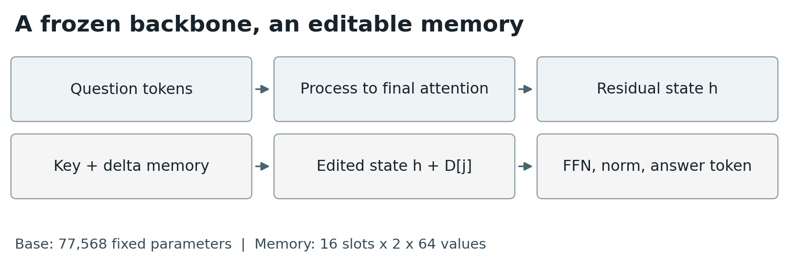
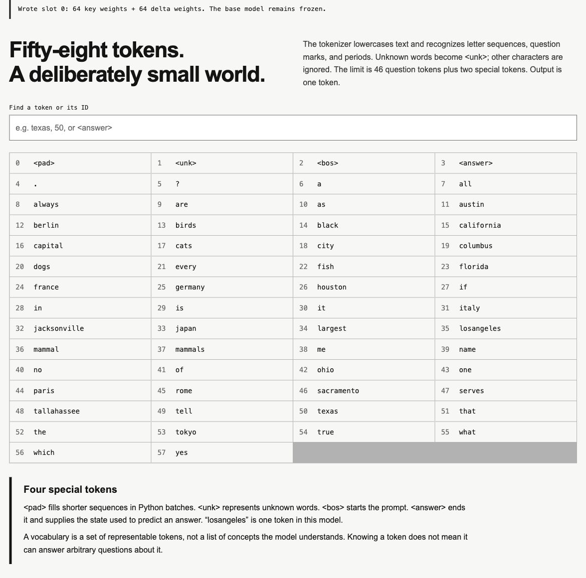
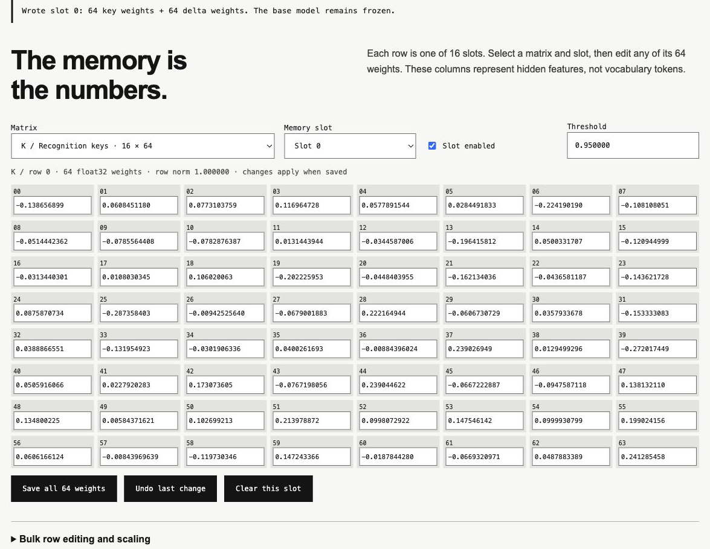
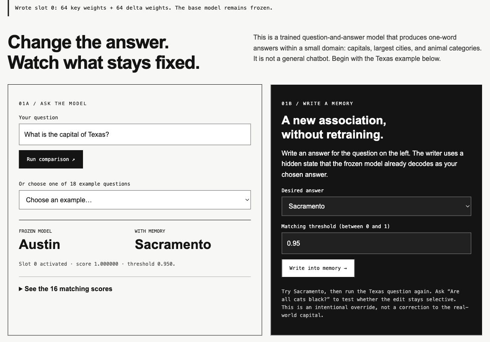

# LAMP: Latent Associative Memory Programming in a Frozen Toy Transformer

William Taggart  
Modern and Classical Languages and Literatures, Virginia Tech  
wtaggart@vt.edu

Report date: November 13, 2026

## Abstract

We introduce LAMP (Latent Associative Memory Programming), an inspectable memory adaptor that changes selected answers of a frozen transformer by directly writing recognition keys and activation differences into two parameter matrices. A writer captures a source question’s hidden state and selects a donor state that the frozen model already decodes into a desired answer. It stores their difference, then conditionally adds that difference to a matching state during inference. Memory writes require forward passes but no gradient-based optimization. A two-block, 77,568-parameter question-and-answer model is augmented with 2,048 memory weights across 16 slots. A counterfactual Texas-capital edit succeeds on the exact source and one of two held-out paraphrases, with no activation on 34 unrelated held-out questions. These results establish a restricted demonstration of selective activation editing, not a general episodic-memory system. A browser implementation exposes the memory weights for direct manipulation.

## Purpose and Research Context

LAMP investigates a small, inspectable form of model modification: freeze a toy transformer's learned weights, attach an initially inactive memory module, and give the user an explicit writer for selected associations. The aim is educational as well as experimental. A user can examine recognition keys and activation displacements, disable individual slots, and compare the original and edited predictions without retraining the base model.

Associative memory provides the broader context for this interface. Hopfield's recurrent networks retrieve stored patterns through network dynamics ([Hopfield, 1982](https://doi.org/10.1073/pnas.79.8.2554)), and modern Hopfield networks connect continuous associative retrieval with attention ([Ramsauer et al., 2020](https://arxiv.org/abs/2008.02217)). Analyses of transformer feed-forward layers as key-value memories offer a comparison within pretrained models ([Geva et al., 2020](https://arxiv.org/abs/2012.14913)). LAMP makes a separate store writable and visible to the user; that design does not confer the storage bounds or convergence guarantees of these other formulations.

*Browser experiment before the memory write: both the frozen base and memory-enabled prediction return Austin.*

The illustrative task changes the answer to "What is the capital of Texas?" from "Austin" to "Sacramento" while seeking to preserve unrelated responses. This is an intentional counterfactual override, not a factual correction. Figure 1 shows the unchanged predictions before a write. The writer then stores a recognition key and a donor-derived activation displacement, and retrieval determines whether to apply that displacement to a later query. Figure 2 shows how the editable memory is positioned around the frozen computation.

*Figure 2. Architecture schematic. Memory intervenes after the final attention residual and before the final feed-forward sublayer; the base parameters remain frozen.*

This intervention boundary distinguishes LAMP from several related editing methods. GRACE uses discrete key-value adaptors for selective edits to a frozen model ([Hartvigsen et al., 2023](https://arxiv.org/abs/2211.11031)); LAMP constructs a donor difference directly instead of optimizing an edit value. ROME and MEMIT change existing model weights for factual associations ([Meng et al., 2022](https://arxiv.org/abs/2202.05262); [Meng et al., 2022](https://arxiv.org/abs/2210.07229)), while MEND learns transformations of gradients for targeted edits ([Mitchell et al., 2021](https://arxiv.org/abs/2110.11309)). Contrastive activation addition also uses activation differences, but LAMP's displacement is source-specific and gated by a stored key ([Rimsky et al., 2024](https://aclanthology.org/2024.acl-long.828/)). These comparisons locate the implementation's contribution in its transparent combination of matching and activation transplantation, rather than in a new claim to associative storage or model editing.

Fast-weight programming connects dynamic numerical updates with associative memory ([Schlag et al., 2021](https://arxiv.org/abs/2102.11174)), and Titans develops memory that learns at test time ([Behrouz et al., 2025](https://arxiv.org/abs/2501.00663)). LAMP's explicit, forward-only writer has a narrower scope: the base is trained once, and subsequent writes use inference to program selected associations. Reversibility and inspection follow from keeping the added memory separate, whereas locality, paraphrase transfer, interference, and scaling remain empirical questions. The report presents the implementation and preliminary checks needed to study those questions in a deliberately limited model.

## Frozen model and insertion point

The base is a causal transformer with two blocks, hidden width $d=64$, four attention heads, and a two-layer GELU feed-forward network of width 128 in each block. It has 58 vocabulary tokens, learned positional embeddings for 48 positions, and an untied output head. It predicts one answer token rather than generating a conversation.

*Vocabulary page showing the small model's token inventory and special-token explanation.*
Inputs include a beginning marker and a final `<answer>` marker. Let $h(x)\in\mathbb{R}^{1\times d}$ be the residual state at that final marker, immediately after the second block’s attention and residual addition. Memory modifies $h$ *before* the second block’s feed-forward LayerNorm, affecting both its feed-forward input and residual path. There is no attention after this point. The remaining computation is
$$
\begin{align}
u &= h' + \operatorname{FFN}_2(\operatorname{LN}_2(h')),\\
F_\theta(h') &= \operatorname{LN}_{\mathrm{final}}(u)W_{\mathrm{out}}^\top,
\end{align}
$$
where $W_{\mathrm{out}}\in\mathbb{R}^{58\times64}$ and all base parameters $\theta$ remain fixed.

| Component                       | Scalar parameters |
|:--------------------------------|------------------:|
| Token and position embeddings   |             6,784 |
| Two transformer blocks          |            66,944 |
| Final LayerNorm and output head |             3,840 |
| Frozen base total               |            77,568 |
| Memory keys and deltas          |             2,048 |

## Memory operations

### Selective retrieval

*Memory editor exposing the recognition-key values and slot controls after the write.*
The adaptor contains $K,D\in\mathbb{R}^{m\times d}$, with $m=16$ and $d=64$, plus an enabled flag $b_i$ and threshold $\tau_i$ for each slot. Both matrices start at zero and every slot starts disabled, making the initial adaptor exactly inactive.

Given a query state $h$, compute
$$
q=\frac{h}{\max(\|h\|_2,\epsilon)},\qquad s=qK^\top\in\mathbb{R}^{1\times m}.
$$
Let $E=\{i:b_i=1,\ s_i\geq\tau_i\}$. If $E$ is nonempty, select $j=\arg\max_{i\in E}s_i$, breaking ties by the lowest index, and set $h'=h+D_j$. Otherwise $h'=h$. The default threshold is $0.95$. Writer-created keys have unit length, making scores cosine similarities. Manual edits do not renormalize keys; their scores are normalized-query dot products and may exceed one.

Matching costs $O(md)$, followed by an $O(d)$ addition. A conceptual one-hot selector $a\in\mathbb{R}^{1\times m}$ gives $h'=h+aD$; the implementation gathers the selected row directly.

### Forward-only donor writer

For a source question $x_s$ and desired answer token $y^\star$, compute $h_s=h(x_s)$ with memory disabled. Run a fixed set $P$ of 18 canonical probe questions through the frozen model. Among probes whose argmax prediction equals $y^\star$, choose the donor with greatest log probability for that token:
$$
x_t=\arg\max_{\substack{x\in P\\\arg\max F_\theta(h(x))=y^\star}}
\log\operatorname{softmax}(F_\theta(h(x)))_{y^\star}.
$$
Selection uses predictions, not probe gold labels; however, $P$ is deliberately constructed for this restricted domain. If no probe predicts the desired answer, the write is rejected. Otherwise write
$$
K_i=\frac{h_s}{\|h_s\|_2},\qquad D_i=h(x_t)-h_s,\qquad b_i=1,\quad\tau_i=0.95.
$$
Each write changes at most 128 floating-point weights, plus metadata. An enabled key with dot product above $1-10^{-5}$ against the normalized source is reused; otherwise the first disabled slot is chosen. A full memory requires clearing or disabling a slot. This replacement rule assumes normal writer-created keys; unrestricted manual edits can alter its behavior.

For the exact source, if its programmed slot wins retrieval,
$$
h_s+D_i=h(x_t).
$$
Thus the remaining deterministic computation reproduces the donor’s full logit vector, up to numerical error. Placement after the final attention operation is essential to this simple single-state argument. Later cross-token attention would introduce dependence on other token states.

For a different question with state $h_s+e$, retrieval instead gives $h(x_t)+e$. Similarity-based activation therefore does not guarantee the requested answer: retrieval and downstream decoding are separate requirements.

## Implementation and preliminary evaluation

The base is trained on 18 facts about capitals, largest cities, animal color universals, and mammal categories. Five templates per fact yield 90 training questions; two other templates yield 36 held-out questions. Held-out templates contribute vocabulary to the tokenizer, but not supervised training pairs. This evaluates wording variation over known facts, not unseen factual knowledge.

*The same experiment after writing slot 0: the base still returns Austin and the memory-enabled prediction returns Sacramento. This is an intentional counterfactual edit.*
Training uses seed 17, AdamW with learning rate $0.003$ and weight decay $0.01$, batches of 48 sampled with replacement, 600 steps, and gradient clipping at norm 1. The checkpoint is then frozen. The following results come from the saved CPU demonstration run; they are not averages over seeds.

| Measurement                                     | Observed result |
|:------------------------------------------------|----------------:|
| Base training accuracy                          |           90/90 |
| Base held-out accuracy                          |           33/36 |
| Exact Texas $\rightarrow$ Sacramento override |        Succeeds |
| Target held-out paraphrases changed             |             1/2 |
| Unrelated held-out memory activations           |            0/34 |
| Blank adaptor vs. base logits                   |       Identical |
| Base parameters after memory writes             |       Unchanged |

The successful target paraphrase has similarity $0.9842$; the unsuccessful one has similarity $0.8439$, below the $0.95$ threshold. All 34 unrelated held-out questions retain their base behavior, including existing base errors. This supports locality only on this small test set.

Functional checks also demonstrate simultaneous Texas $\rightarrow$ Sacramento and cats-black $\rightarrow$ yes associations; replacement of Texas with Paris in the same slot; persistence after reload; and restoration of baseline behavior after clearing memory. These checks do not establish capacity at 16 occupied slots.

A dependency-free JavaScript port executes the actual transformer from exported FP32 weights. Across all 126 training and held-out questions, its base argmax predictions match Python, with maximum observed absolute logit difference approximately $3.02\times10^{-6}$. JavaScript arithmetic and an approximate error function for GELU introduce numerical differences. Raw base weights occupy 310,272 bytes; the memory matrices require 8,192 bytes in FP32, excluding metadata and serialization overhead.

Python checkpoints and browser-local storage preserve memories across sessions. The browser interface provides numeric import/export, raw weight editing, and undo. Persistence is explicit storage, not automatic learning during inference.

## Limitations and next experiments

This memory is an explicit latent association table with one slot per edit. Storing its arrays as parameters does not demonstrate dense consolidation of many experiences into shared base weights. Neither readable question strings nor answer IDs are stored in these arrays, but fixed probe questions and a tokenizer remain part of the application.

The writer cannot introduce new vocabulary or guarantee a donor for every token. The model supports one-token answers, explicit writes, and limited paraphrase generalization. It does not record every forward pass, reconstruct past questions, or provide conversational episodic recall. Arbitrary raw edits have no guaranteed semantic interpretation. Multiple eligible slots compete through hard selection, and thresholds trade recall against unintended activation.

Next experiments should evaluate multiple training seeds, all occupied slots, threshold sweeps, and harder negative queries. Baselines should include nearest-neighbor output substitution and optimized adaptor values. Longer answers and earlier insertion points require additional mechanisms and fresh evaluation.

## Conclusion

A frozen toy transformer can be selectively redirected by storing a normalized recognition key and a donor-minus-source hidden-state difference. The construction gives an exact-source guarantee under successful retrieval and a transparent interface for inspecting memory weights. Its principal value is an executable educational demonstration of forward-only associative editing, with bounded claims about memory and generalization.

## AI-use disclosure

This project was created with assistance from GPT-6 Astra and Codex. AI tools supported software development, technical exploration, and drafting and revision of the report. William Taggart is responsible for the research decisions and final software and documentation. AI assistance does not constitute independent validation of the implementation or its scientific claims.

## References

1. Hartvigsen and others. 2023. *Aging with GRACE: Lifelong Model Editing with Discrete Key-Value Adaptors*. NeurIPS. [https://arxiv.org/abs/2211.11031](https://arxiv.org/abs/2211.11031).

2. Meng and others. 2022. *Locating and Editing Factual Associations in GPT*. NeurIPS. [https://arxiv.org/abs/2202.05262](https://arxiv.org/abs/2202.05262).

3. Rimsky and others. 2024. *Steering Llama 2 via Contrastive Activation Addition*. ACL. [https://aclanthology.org/2024.acl-long.828/](https://aclanthology.org/2024.acl-long.828/).

4. Schlag and Irie and Schmidhuber. 2021. *Linear Transformers Are Secretly Fast Weight Programmers*. ICML. [https://arxiv.org/abs/2102.11174](https://arxiv.org/abs/2102.11174).

5. Behrouz and Zhong and Mirrokni. 2025. *Titans: Learning to Memorize at Test Time*. arXiv:2501.00663. [https://arxiv.org/abs/2501.00663](https://arxiv.org/abs/2501.00663).
6. J J Hopfield (1982). [Neural networks and physical systems with emergent collective computational abilities.](https://doi.org/10.1073/pnas.79.8.2554). Proceedings of the National Academy of Sciences. DOI: 10.1073/pnas.79.8.2554.

7. Ramsauer, Hubert, Schäfl, Bernhard, Lehner, Johannes, Seidl, Philipp, Widrich, Michael, Adler, Thomas, Gruber, Lukas, Holzleitner, Markus, Pavlović, Milena, Sandve, Geir Kjetil, Greiff, Victor, Kreil, David, Kopp, Michael, Klambauer, Günter, Brandstetter, Johannes, Hochreiter, Sepp (2020). [Hopfield Networks is All You Need](https://arxiv.org/abs/2008.02217). DOI: 10.48550/arXiv.2008.02217.

8. Geva, Mor, Schuster, Roei, Berant, Jonathan, Levy, Omer (2020). [Transformer Feed-Forward Layers Are Key-Value Memories](https://arxiv.org/abs/2012.14913). DOI: 10.48550/arXiv.2012.14913.

9. Mitchell, Eric, Lin, Charles, Bosselut, Antoine, Finn, Chelsea, Manning, Christopher D. (2021). [Fast Model Editing at Scale](https://arxiv.org/abs/2110.11309). DOI: 10.48550/arXiv.2110.11309.

10. Meng, Kevin, Sharma, Arnab Sen, Andonian, Alex, Belinkov, Yonatan, Bau, David (2022). [Mass-Editing Memory in a Transformer](https://arxiv.org/abs/2210.07229). DOI: 10.48550/arXiv.2210.07229.

## Suggested citation

William Taggart. 2026. LAMP: Latent Associative Memory Programming in a Frozen Toy Transformer. Technical report. Modern and Classical Languages and Literatures, Virginia Tech. November 13, 2026. https://github.com/FL2744/LAMP
